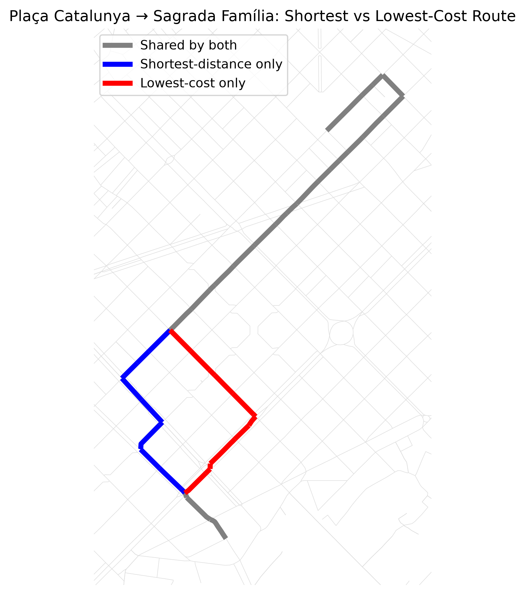
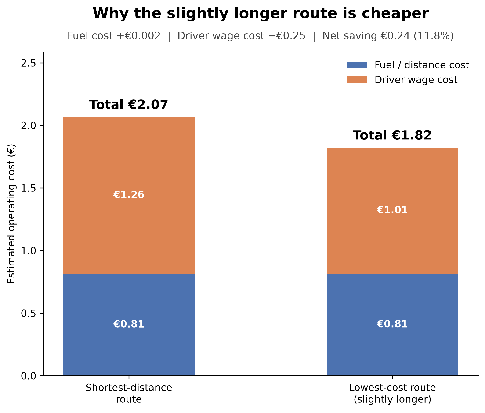

# Barcelona Route Cost Optimizer

A route optimization project that tests a simple operational question:

> **Does the shortest route actually minimize operating cost, or can a slightly longer route be cheaper because it saves driver time?**

Using Barcelona's OpenStreetMap road network, the project compares three routing strategies for a Plaça Catalunya → Sagrada Família case study:

- Shortest distance
- Fastest travel time
- Lowest estimated operating cost

The pipeline combines **Python, OSMnx, NetworkX, DuckDB, and dbt** to move from raw road-network data to tested analytical models and a business-facing result.

## Key Finding

For this case study, the **lowest-cost route is slightly longer than the shortest-distance route, but cheaper because driver-time savings outweigh the tiny additional distance cost.**

| Strategy | Distance | Travel Time | Fuel / Distance Cost | Driver Wage Cost | Total Cost |
|---|---:|---:|---:|---:|---:|
| Shortest distance | 3.248 km | 5.02 min | €0.812 | €1.255 | €2.067 |
| Lowest cost | 3.254 km | 4.04 min | €0.814 | €1.009 | €1.823 |

**Trade-off:**

**+6.3 m distance → −59 sec driver time → ~€0.24 lower operating cost → ~11.8% savings**

The fastest-time and lowest-cost strategies produced the same physical route for this case study.

## Route Comparison



The routes share most of their road segments.

- **Gray:** shared by both strategies
- **Blue:** shortest-distance route only
- **Red:** lowest-cost route only

The differing section shows how minimizing operating cost can select a different path from minimizing distance alone.

## Why the Longer Route Is Cheaper



The additional distance increases estimated fuel/distance cost by only about **€0.002**.

At the same time, the faster route reduces estimated driver wage cost by approximately **€0.246**.

The time saving therefore outweighs the tiny additional distance cost.

## Cost Model

Each road segment receives an estimated operating cost:

`total operating cost = distance cost + driver time cost`

Assumptions used in the case study:

- Distance/fuel rate: **€0.25 per km**
- Driver wage rate: **€0.25 per minute (€15/hour)**

For every road edge:

`distance cost = distance_km × €0.25`

`driver wage cost = travel_time_min × €0.25`

`total cost = distance cost + driver wage cost`

These assumptions are intentionally simple and configurable. They demonstrate the optimization architecture rather than represent a universal fleet cost model.

## Routing Logic

The same origin and destination are evaluated using three NetworkX shortest-path calculations with different optimization weights:

| Strategy | Optimization Weight |
|---|---|
| Shortest distance | Road length |
| Fastest time | Estimated travel time |
| Lowest cost | Estimated operating cost |

This separates the **business objective** from the routing algorithm: the graph remains the same while the optimization target changes.

## Data Pipeline

```text
OpenStreetMap
      ↓
Python + OSMnx
      ↓
Barcelona road graph
      ↓
NetworkX route optimization
      ↓
DuckDB
      ↓
dbt staging
      ↓
dbt intermediate comparison
      ↓
dbt business mart
      ↓
Business finding + visualizations
```

### Python / OSMnx / NetworkX

Python downloads the drivable Barcelona road network from OpenStreetMap through OSMnx.

Each road edge is enriched with:

- distance
- estimated travel time
- distance/fuel cost
- driver wage cost
- total estimated operating cost

NetworkX then calculates the three route strategies.

### DuckDB

The resulting route-level metrics are persisted to DuckDB as `route_results`.

This separates route computation from the downstream analytical transformation layer.

### dbt

The dbt project transforms the route results through three layers:

```text
route_results
     ↓
stg_route_results
     ↓
int_route_comparison
     ↓
mart_route_efficiency
```

**Staging**

`stg_route_results` exposes and standardizes the route-level output generated by Python.

**Intermediate**

`int_route_comparison` compares every strategy with the shortest-distance baseline and calculates:

- additional distance
- travel-time difference
- fuel/distance cost difference
- driver wage cost difference
- total operating-cost difference
- cost-saving percentage

**Mart**

`mart_route_efficiency` provides the business-facing output, including a readable explanation of whether a route is cheaper despite travelling farther.

## Data Quality

dbt tests validate the final mart's route strategy field for:

- `not_null`
- `unique`
- accepted values:
  - `shortest_distance`
  - `fastest_time`
  - `lowest_cost`

The transformation logic also checks that the total cost difference is consistent with its component differences:

`total cost difference ≈ fuel cost difference + wage cost difference`

## Project Structure

```text
barcelona-route-optimizer/
│
├── route_optimizer.py
├── route_comparison.png
├── cost_breakdown.png
├── README.md
│
└── dbt_barcelona/
    ├── dbt_project.yml
    ├── models/
    │   ├── staging/
    │   │   ├── stg_route_results.sql
    │   │   └── sources.yml
    │   ├── intermediate/
    │   │   └── int_route_comparison.sql
    │   └── marts/
    │       ├── mart_route_efficiency.sql
    │       └── mart_route_efficiency.yml
    └── tests/
        └── test_cost_difference_math.sql
```

## Tech Stack

**Python** — route processing, cost calculation and visualization  
**OSMnx** — OpenStreetMap road-network extraction  
**NetworkX** — weighted shortest-path optimization  
**Pandas** — route-result processing  
**DuckDB** — local analytical storage  
**dbt Core** — transformation, lineage and data-quality testing  
**Matplotlib** — route and cost visualizations

## Limitations

This is a focused optimization case study, not a production navigation system.

The model currently:

- evaluates one Barcelona origin/destination case study
- uses estimated road speeds rather than live traffic
- uses simplified distance and wage cost assumptions
- does not model parking, tolls, vehicle-specific fuel consumption, delivery windows or real-time congestion

The purpose is to demonstrate how operational routing decisions can be modeled around **business cost rather than distance alone**, with a reproducible analytics pipeline from road-network data to a tested business mart.